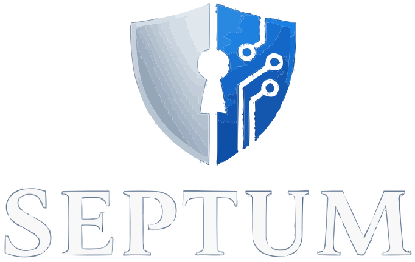

<p align="center">
  
</p>

<h3 align="center">Veriniz dışarı çıkmaz. Yapay zekanız çalışmaya devam eder.</h3>

https://github.com/user-attachments/assets/eb3ea068-2e1c-41e9-b67c-0a8a3f19ec05

<p align="center">
  <a href="https://github.com/byerlikaya/Septum/actions/workflows/tests.yml">
    
  </a>
  <a href="LICENSE">
    
  </a>
  <a href="README.md">
    
  </a>
  <a href="https://github.com/crewforth/crewforth">
    
  </a>
</p>

<p align="center">
  <a href="https://byerlikaya.github.io/Septum/tr/"><strong>🏠 Dokümantasyon</strong></a>
  &nbsp;·&nbsp;
  <a href="https://byerlikaya.github.io/Septum/tr/installation"><strong>🚀 Kurulum</strong></a>
  &nbsp;·&nbsp;
  <a href="https://byerlikaya.github.io/Septum/tr/features"><strong>✨ Özellikler</strong></a>
  &nbsp;·&nbsp;
  <a href="https://byerlikaya.github.io/Septum/tr/architecture"><strong>🏗️ Mimari</strong></a>
</p>

---

## Septum Nedir?

Septum, gizlilik öncelikli bir AI ara katmanıdır. Kendi dokümanlarınızı yükleyip bu dokümanlar hakkında, ya da sohbet ederek ChatGPT, Claude, Gemini ya da başka bir bulut LLM'ine soru sorarsınız. Makinenizden hiçbir şey çıkmadan önce Septum kişisel bilgileri tespit eder ve yerine placeholder koyar.

Bulut LLM'leri şirket bilgisinde çok işe yarar; ama bu bilginin içinde isimler, kimlik numaraları, telefonlar ve adresler vardır. Septum bu değerleri bulut isteğinin dışında tutar, sizin okuduğunuz cevapta ise gerçek değerleri geri yazar. Bulut modeli işi yapar, kişisel veriyi görmez.

Septum aynı anda birden çok gizlilik regülasyonunu uygular (17 hazır paket; en kısıtlayıcı kural geçerli olur) ve ham kişisel veri içermeyen bir denetim kaydı tutar.

## Nasıl çalışır?

1. **Yerelde maskele.** Dokümanlarınız ve yazdığınız sorular yerel tespitten geçer. Her kişisel değer `[PERSON_NAME_1]` gibi bir placeholder'a dönüşür.
2. **İncele.** Onay kapısı açıkken, göndermeden önce maskeli soruyu, getirilen parçaları ve tam isteği görürsünüz.
3. **Bulut LLM'ine sor.** Yalnızca maskeli metin gönderilir.
4. **Yerelde geri yaz.** Cevaptaki placeholder'lar makinenizde gerçek değerlerle değiştirilir.

```
Doküman parçası:  Elif Demir (TCKN 10000000146) taburcu edildi.
Buluta giden:     [PERSON_NAME_1] (TCKN [NATIONAL_ID_1]) taburcu edildi.
```

## Hızlı başlangıç

```bash
git clone https://github.com/byerlikaya/Septum.git && cd Septum
docker compose -f docker-compose.standalone.yml up --build
```

**http://localhost:3000** adresini açın. Kurulum sihirbazı önce container günlüğüne yazdırılan bir kurulum anahtarı ister (`docker compose -f docker-compose.standalone.yml logs septum`). Ardından veritabanı, cache, LLM sağlayıcısı, regülasyonlar ve yönetici hesabını yapılandırır. Tam yığın, air-gapped ve internete açık bölgelerin ayrımı ya da kaynaktan kurulum için [Kurulum Rehberi](https://byerlikaya.github.io/Septum/tr/installation) sayfasına bakın.

## Dokümantasyon

- [Kurulum](https://byerlikaya.github.io/Septum/tr/installation): topolojiler, kurulum sihirbazı, güncelleme, sorun giderme
- [Özellikler](https://byerlikaya.github.io/Septum/tr/features): tespit hattı, regülasyon paketleri, MCP sunucusu, REST API
- [Mimari](https://byerlikaya.github.io/Septum/tr/architecture): modüller, güvenlik bölgeleri, model bütünlüğü, denetim kaydı
- [İş akışları](https://byerlikaya.github.io/Septum/tr/workflows) ve [Kullanım senaryoları](https://byerlikaya.github.io/Septum/tr/use-cases)
- [Benchmark](https://byerlikaya.github.io/Septum/tr/benchmark): regülasyon ve veri kaynağı bazında tespit sonuçları
- [Değişiklik günlüğü](https://byerlikaya.github.io/Septum/tr/changelog)
- [Katkıda bulunma](CONTRIBUTING.tr.md)

## Destek ve lisans

Septum, MIT lisansıyla açık kaynak bir projedir; ayrıntılar için [LICENSE](LICENSE) dosyasına bakın. Size faydalı olduysa [GitHub'da](https://github.com/byerlikaya/Septum) repoyu yıldızlayın ve ihtiyacınız olan bir hata ya da eksik özellik için issue açın.
