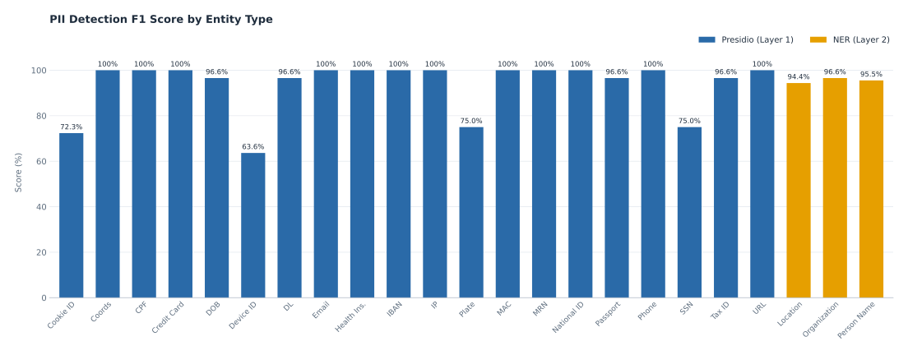
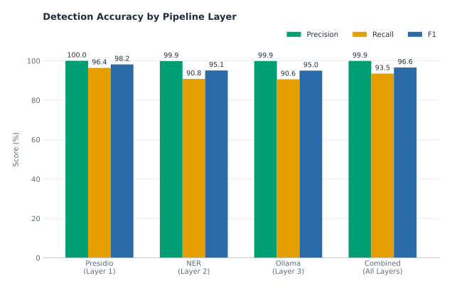
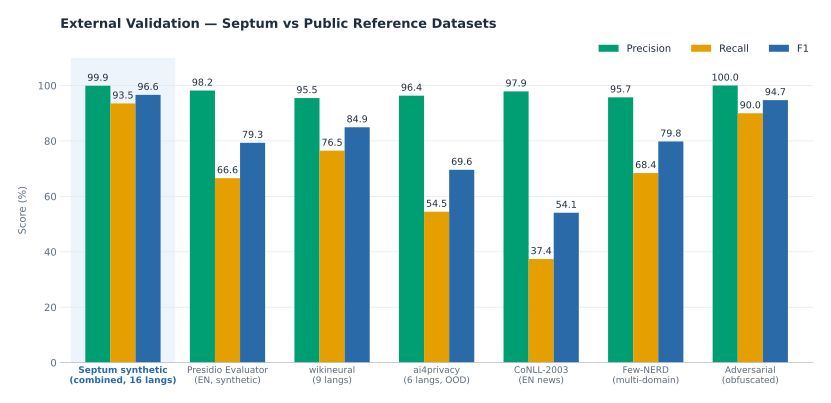
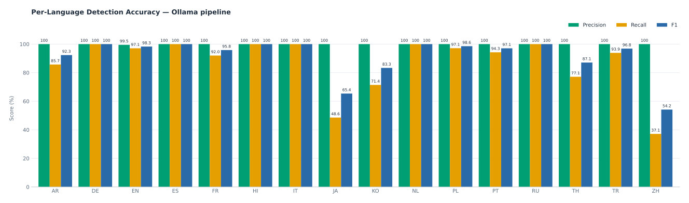

# Septum — Benchmark Results

<p align="center">
  <a href="./index.md"><strong>🏠 Home</strong></a>
  &nbsp;·&nbsp;
  <a href="installation.md"><strong>🚀 Installation</strong></a>
  &nbsp;·&nbsp;
  <strong>📈 Benchmark</strong>
  &nbsp;·&nbsp;
  <a href="features.md"><strong>✨ Features</strong></a>
  &nbsp;·&nbsp;
  <a href="architecture.md"><strong>🏗️ Architecture</strong></a>
  &nbsp;·&nbsp;
  <a href="document-ingestion.md"><strong>📊 Document Ingestion</strong></a>
  &nbsp;·&nbsp;
  <a href="screenshots.md"><strong>📸 Screenshots</strong></a>
</p>

---

All 17 built-in regulations active, evaluated across **five independent data sources plus two robustness probes**:

1. **Septum synthetic corpus** — **3,468 algorithmically generated PII values** across 23 entity types in **16 languages** (ar, de, en, es, fr, hi, it, ja, ko, nl, pl, pt, ru, th, tr, zh). The only way to cover checksummed IDs (valid Luhn, IBAN MOD-97, TCKN) that no public dataset carries, plus a 31-doc semantic-contextual subset (60 entities across DIAGNOSIS / MEDICATION / RELIGION / POLITICAL_OPINION / ETHNICITY / SEXUAL_ORIENTATION) that measures Ollama's unique contribution. Fixed seed — fully reproducible.
2. **Microsoft [presidio-evaluator](https://github.com/microsoft/presidio-research)** — 200 synthetic Faker sentences, the reference PII evaluation framework used by the Presidio team. Entity map excludes DATE_TIME / TIME / TITLE / SEX / CARDISSUER / NRP. These labels are excluded from the detection benchmark by design, so the recall number reflects masking quality, not category mismatches.
3. **[Babelscape/wikineural](https://huggingface.co/datasets/Babelscape/wikineural)** — 50 Wikipedia held-out sentences × 9 languages, used here as evaluation data only. It is the dataset, not the Babelscape wikineural model, which Septum no longer uses. Caveat: the XLM-RoBERTa NER models of the earlier NER set were trained on the related [WikiANN corpus](https://huggingface.co/datasets/unimelb-nlp/wikiann), so these numbers read as a near-upper bound rather than a strict out-of-distribution test.
4. **[ai4privacy/pii-masking-300k](https://huggingface.co/datasets/ai4privacy/pii-masking-300k)** — 50 validation samples × 6 languages (en/de/fr/es/it/nl). Modern PII-specific dataset built from scratch; the models Septum uses were NOT trained on it, so this is the closest the benchmark gets to a true out-of-distribution check.
5. **[CoNLL-2003](https://aclanthology.org/W03-0419/)** — 200 samples from the classical EN news-domain held-out test split. Not in any Septum-relevant training corpus.
6. **[DFKI-SLT/few-nerd](https://huggingface.co/datasets/DFKI-SLT/few-nerd)** (supervised split) — multi-domain Wikipedia NER used as a cross-domain robustness probe. Only person / organization / location map to Septum's PII categories.
7. **Robustness probes** — 15 PII-free paragraphs in 9 languages (false-positive rate) + 18 obfuscated PII inputs (leetspeak, Unicode homoglyphs, zero-width joiners, mixed-case emails, bracketed emails, escaped credit cards, line-wrapped TCKNs and IBANs, international phone formats, "at / dot" ASCII obfuscation).

<p align="center">
  <a href="#septum--benchmark-results"></a>
</p>

<p align="center">
  <a href="#septum--benchmark-results"></a>
</p>

> **Measured with the previous NER model set.** The NER defaults have since changed. The earlier set used the Babelscape wikineural model for de, it, nl, pl and ru, and as the fallback for every unlisted language; XLM-RoBERTa WikiANN served en, ar, zh, es, fr, pt, hi, bn, ur, vi and ja; Turkish had its own models. Davlan mBERT-hrl now serves zh, ja, ko, de, it, nl, pl, ru and the fallback languages, and the wikineural model is no longer used. Figures that depend on the NER layer (the NER and Combined rows, the Ollama ablation, the external datasets, the per-language breakdown) were measured with the earlier set. Those detection figures have not been re-measured, so no new detection figures exist for the current defaults. The retrieval run and its leak check were re-run on the current defaults; see the retrieval section below. The Babelscape/wikineural row below is evaluation data, not the removed model. The current mapping is in [Document Ingestion](document-ingestion.md#ner-model-coverage).

## Septum synthetic corpus (per-layer)

| Layer | Entities | Types | Precision | Recall | F1 |
|:---|:---:|:---:|:---:|:---:|:---:|
| **Presidio (L1)** — patterns + validators (controlled + extended + adversarial) | 1,710 | 20 | 100% | 96.4% | 98.2% |
| **NER (L2, previous NER set)** — XLM-RoBERTa + ALL CAPS normalisation (16 languages) | 840 | 3 | 99.9% | 90.8% | 95.1% |
| **Ollama (L3)** — aya-expanse:8b (alias + semantic-contextual) | 918 | 9 | 99.9% | 90.6% | 95.0% |
| **Combined** | **3,468** | **23** | **99.9%** | **93.5%** | **96.6%** |

**Ollama semantic subset** (DIAGNOSIS / MEDICATION / RELIGION / POLITICAL_OPINION / ETHNICITY / SEXUAL_ORIENTATION — entity types Presidio and NER cannot express): 60 entities across 31 docs, **F1 96.6%** (Precision 98.3%, Recall 95.0%).

**Ollama ablation** — same 205-doc corpus (semantic + alias + NER) with Ollama OFF vs ON: **+3.49 pp recall, +1.95 pp F1**. This is the honest measurement of Ollama's marginal value; on the semantic subset alone Ollama lifts recall from near-zero to 95% because no other layer can express those categories.

## External reference datasets

| Source | Entities | Types | Precision | Recall | F1 |
|:---|:---:|:---:|:---:|:---:|:---:|
| **Microsoft presidio-evaluator** (EN, synthetic Faker, 200 samples; previous NER set) | 326 | 11 | 98.2% | 66.6% | 79.3% |
| **Babelscape/wikineural** dataset (9 langs × 50 = 450 samples, held-out Wikipedia NER; previous NER set) | 634 | 3 | 95.5% | 76.5% | 84.9% |
| **ai4privacy/pii-masking-300k** (6 langs, real OOD — not in training data; previous NER set) | 1,456 | 12 | 96.4% | 54.5% | 69.6% |
| **CoNLL-2003** (EN news, 372 PER/ORG/LOC scored + 35 MISC excluded by design; previous NER set) | 372 | 3 | 97.9% | 37.4% | 54.1% |
| **DFKI-SLT/few-nerd** (multi-domain Wikipedia, 200 test samples; previous NER set) | 361 | 3 | 95.7% | 68.4% | 79.8% |

CoNLL-2003 recall is partly structural: 35 of 407 gold entities (**8.6%**) are MISC-class — nationalities, events, works-of-art — that are not PII under any of Septum's 17 regulation packs and are intentionally excluded from scoring. The headline 54.1% reflects recall *after* MISC is dropped and combines (a) Septum's deliberate policy that bare place names in free news text are not PII by themselves ([GDPR Art. 4(1)](https://gdpr-info.eu/art-4-gdpr/) rationale) with (b) the conservative LOCATION / ORGANIZATION gates on short single-token mentions. Ai4Privacy exposes real gaps around USERNAME and fine-grained address sub-types that the current regulation packs do not target directly — that's actionable signal, not a rounding error.

<p align="center">
  <a href="#septum--benchmark-results"></a>
</p>

## Robustness

| Probe | Volume | Result |
|:---|:---:|:---:|
| **Clean-text false-positive rate** (15 PII-free paragraphs, 439 tokens across 9 languages) | 0 FP | **0.00 FP / 1k tokens** |
| **Adversarial pack** (18 realistic obfuscated PII inputs: leetspeak, Unicode homoglyphs, zero-width joiners, mixed-case emails, bracketed emails, escaped credit cards, line-wrapped TCKNs and IBANs, international phone formats, "at / dot" ASCII obfuscation) | 20 planted | P 100% · R 90.0% · **F1 94.7%** |

The adversarial pack is intentionally biased toward the attempts a real user or attacker would type — contrived triple-spaced IBANs and other "nobody would actually paste this" constructions are excluded so the score reflects real-world resilience rather than stress-test theatre. The 10% recall gap is where an obfuscation-normalising custom-rules layer would pay off.

## Per-language breakdown (Ollama pipeline)

<p align="center">
  <a href="#septum--benchmark-results"></a>
</p>

Measured with the previous NER set, F1 is uniform and very high across Latin-script languages (EN 98.3%, DE 100%, ES 100%, FR 95.8%, IT 100%, NL 100%, PL 98.6%, PT 97.1%, RU 100%, TR 96.8%) and remains strong on Arabic (92.3%) and Hindi (100%). The honest weak spots are CJK and Thai: **Thai 87.1%, Korean 83.3%, Japanese 65.4%, Chinese 54.2%**. The CJK minimum-span-length floor is now language-aware (2 glyphs for ZH / JA / KO / TH, 3 elsewhere) which already lifted Chinese from 44.4% to 54.2%; closing the rest of the gap requires per-language NER fine-tuning, which is on the roadmap, not claimed to be solved today.

> NER (L2) detects ALL CAPS names (common in medical/legal documents) via
> automatic titlecase normalisation, and recognises organisation names.
> LOCATION output goes through a conservative gate (multi-word OR confidence
> ≥ 0.95) so common-noun mis-fires like Turkish "Doğum" or German form
> headers are filtered out while real placenames like "İstanbul", "Berlin"
> still pass through. Ollama (L3) validates candidates and catches aliases.
> Benchmark includes adversarial edge cases (spaced IBANs, dotted phone
> numbers, etc.) that lower Presidio recall to real-world levels.
> Reproducible: [`pytest packages/api/tests/benchmark_detection.py -v -s`](../packages/api/tests/benchmark_detection.py)

## Coverage & limitations

**No PII detection system is 100% accurate.** Septum's benchmark is
transparent about where it wins and where it does not:

- **LOCATION output passes through a multi-word-or-high-score gate** (same
  shape as ORGANIZATION_NAME). Multilingual NER models produce
  stochastic single-token LOC mis-fires on common nouns and form-field
  headers in every language Septum supports (Turkish "Doğum", German form
  headers, etc.); chasing those per-language via stopword lists does not
  scale across the 50+ locales the middleware must handle. The gate drops
  single-token spans below 0.95 confidence — real placenames like
  "İstanbul", "Berlin" routinely score 0.97+ and multi-word locations
  ("New York") bypass the score gate entirely. Structured address PII is
  additionally captured by Presidio's `StructuralAddressRecognizer` and
  the per-regulation POSTAL_ADDRESS / STREET_ADDRESS recognisers.
- **All 41 regulation entity types are detectable.** The count is the union of the `ENTITY_TYPES` of the 17 built-in recognizer packs. Detection comes from the Presidio, NER and Ollama layers and from parent-type coverage (FIRST_NAME by PERSON_NAME, CITY by LOCATION, etc.).
- **23 entity types are actively benchmarked** across 3,468 values in 16
  languages with adversarial edge cases.
- **Semantic types** (DIAGNOSIS, MEDICATION, RELIGION, POLITICAL_OPINION)
  are detected only by the Ollama layer and require a local LLM to be
  running.
- **Context-dependent recognisers** (DATE_OF_BIRTH, PASSPORT_NUMBER, SSN,
  TAX_ID) require contextual keywords near the value to reduce false
  positives. Multilingual keyword lists cover 8+ languages.
- **Adversarial formats** (spaced TCKNs, dotted phone numbers) show lower
  detection rates than controlled-format tests. Reported honestly in the
  benchmark.
- **NER coverage is uneven.** Thai NER is effectively absent, and Chinese, Japanese, Korean and Russian NER recall is limited. See [Document Ingestion](document-ingestion.md#ner-model-coverage).

**The Approval Gate is the safety net.** Before any text is sent to the
LLM, you see exactly what will be transmitted and can reject it.
Automated detection reduces risk; human review eliminates it.

Benchmark models (previous NER set): NER used [`akdeniz27/xlm-roberta-base-turkish-ner`](https://huggingface.co/akdeniz27/xlm-roberta-base-turkish-ner) for Turkish
and [`Davlan/xlm-roberta-base-wikiann-ner`](https://huggingface.co/Davlan/xlm-roberta-base-wikiann-ner) for the other languages, with the Babelscape wikineural model for de, it, nl, pl and ru, and as the fallback for unlisted languages. The current per-language models are in [Document Ingestion](document-ingestion.md#ner-model-coverage). Ollama
layer uses [`aya-expanse:8b`](https://ollama.com/library/aya-expanse). Larger Ollama models generally improve
semantic detection at the cost of latency.

## Ollama model comparison (L3 layer)

The L3 semantic layer is model-pluggable; the harness accepts
`SEPTUM_BENCHMARK_OLLAMA_MODEL=<model>` to swap the candidate. Run the
multi-model driver and the table below will be filled from live results
on your hardware:

```bash
./scripts/benchmark_ollama_models.sh                          # default trio
./scripts/benchmark_ollama_models.sh llama3.2:3b qwen2.5:14b  # custom set
```

| Model | Params | VRAM ≈ | Precision | Recall | F1 | Notes |
|:---|:---:|:---:|:---:|:---:|:---:|:---|
| [`llama3.2:3b`](https://ollama.com/library/llama3.2) | 3 B | 3 GB | _TBD_ | _TBD_ | _TBD_ | Fastest, lowest semantic recall expected |
| [`aya-expanse:8b`](https://ollama.com/library/aya-expanse) | 8 B | 5 GB | 99.9% | 90.6% | 95.0% | Current default; multilingual-tuned |
| [`qwen2.5:14b`](https://ollama.com/library/qwen2.5) | 14 B | 9 GB | _TBD_ | _TBD_ | _TBD_ | Highest accuracy expected; ~3× latency vs 8 B |

Numbers above the per-layer table reflect the default `aya-expanse:8b`
run; results for the other models depend on the host (CPU / GPU,
Ollama version, system prompt locale) and are intentionally left
**TBD** until the user reports them with the runner script. Latency
varies linearly with parameter count on CPU; on a single 24 GB GPU,
14 B models still fit but the ~3× longer per-call cost dominates the
ingestion pipeline.

## Retrieval benchmark

This benchmark measures retrieval, not PII detection. The sanitizer runs with its NER layer on, using the current NER defaults (see [NER model coverage](document-ingestion.md#ner-model-coverage)), so the figures and the leak check here reflect those defaults. For each question it asks whether the search stack returns the chunk that holds the answer, once with the raw question and once with the sanitized question. It is the baseline that later changes to chunking, the embedding model and reranking are compared against.

The run uses the document chunker, the per-chunk sanitizer, the FAISS vector store and the BM25 index. Dense, BM25 and hybrid retrieval call the production VectorStore and BM25 code, including `VectorStore.hybrid_search`. auto_rag mirrors chat's cross-document search: the same relevance threshold and per-document candidate count, and a parity test pins the threshold, the per-document candidate count and the candidate cap against chat's implementation. The benchmark runs the per-document searches serially, while production runs them concurrently, so the auto_rag latency is an upper bound. No LLM is called, and the run works offline against a pinned embedder.

### Eval set

| Item | Value |
|:---|:---|
| Documents | 30 synthetic documents: 10 English, 10 Turkish, 10 Chinese |
| Questions | 140: 129 answerable, 11 negative |
| Answerable, by type | lexical 45 · paraphrase 45 · entity 24 · cross-lingual 15 |
| Negative | 11 questions that none of the documents answers |
| Index | 187 chunks; every chunk maps to a span of its source document |
| Digest | `df81576cd611d809dd59eed997ec789cced8315301796ea75bcc11b97179efec` (SHA-256 over every fixture file) |

Documents and questions are hand-written. Each personal-data slot in a document is filled with a value from a seeded generator (seed 42). A question that refers to such a value uses the value of its own document, so a run always produces the same text.

### Setup

| Item | Value |
|:---|:---|
| Embedding model | `sentence-transformers/paraphrase-multilingual-MiniLM-L12-v2`, revision `e8f8c211226b894fcb81acc59f3b34ba3efd5f42` (pinned) |
| Dimension | 384 |
| Chunker | `pipeline`. The 18 plain-text documents use a sliding window of 800 characters with 200 overlap. The 12 documents labelled PDF use the structured chunker with a maximum of 1,200 characters; their text is passed in directly, with no PDF parsing |
| Retrieval | top 10; auto-RAG relevance threshold 0.35 |
| Query modes | raw and sanitized; sanitized is the headline |
| Confidence intervals | 95% percentile bootstrap of the mean, 1,000 resamples, seed 42 |
| Latency | 5 timed repeats per query, sanitized queries, one retriever call including query embedding |
| Hardware | Apple M4 Max, 14 CPU cores, 10 torch threads, Darwin 27.0.0 arm64 |
| Seed | 42 |
| Commit | `67b3ba07`, the `git_sha` recorded in the run output |

### Results

**Headline: sanitized query, hybrid search.** Each cell is mean [95% CI].

| Language | n | Recall@5 | Recall@10 | MRR | nDCG@10 |
|:---|:---:|:---:|:---:|:---:|:---:|
| en | 43 | 0.930 [0.860, 1.000] | 1.000 [1.000, 1.000] | 0.661 [0.553, 0.763] | 0.737 [0.655, 0.820] |
| tr | 43 | 0.977 [0.930, 1.000] | 1.000 [1.000, 1.000] | 0.841 [0.752, 0.919] | 0.880 [0.812, 0.939] |
| zh | 43 | 0.953 [0.884, 1.000] | 1.000 [1.000, 1.000] | 0.772 [0.670, 0.855] | 0.828 [0.751, 0.891] |
| **overall** | **129** | **0.953 [0.915, 0.984]** | **1.000 [1.000, 1.000]** | **0.758 [0.699, 0.807]** | **0.815 [0.771, 0.853]** |

Compared with the previously recorded baseline, sanitized hybrid MRR drops from 0.772 to 0.758 and Recall@5 from 0.961 to 0.953, because organisation and place names now become placeholders.

**Retrievers compared (overall, n = 129), raw and sanitized query modes.**

| Retriever | Mode | Recall@5 | Recall@10 | MRR | nDCG@10 |
|:---|:---|:---:|:---:|:---:|:---:|
| dense | raw | 0.953 [0.907, 0.984] | 1.000 [1.000, 1.000] | 0.748 [0.690, 0.801] | 0.809 [0.765, 0.849] |
| dense | sanitized | 0.938 [0.891, 0.977] | 1.000 [1.000, 1.000] | 0.716 [0.657, 0.772] | 0.786 [0.741, 0.828] |
| bm25 | raw | 0.930 [0.876, 0.969] | 1.000 [1.000, 1.000] | 0.740 [0.677, 0.796] | 0.799 [0.753, 0.842] |
| bm25 | sanitized | 0.915 [0.860, 0.953] | 1.000 [1.000, 1.000] | 0.741 [0.679, 0.798] | 0.799 [0.753, 0.843] |
| hybrid | raw | 0.961 [0.922, 0.992] | 1.000 [1.000, 1.000] | 0.783 [0.724, 0.834] | 0.833 [0.787, 0.872] |
| hybrid | sanitized | 0.953 [0.915, 0.984] | 1.000 [1.000, 1.000] | 0.758 [0.699, 0.807] | 0.815 [0.771, 0.853] |
| auto_rag | raw | 0.550 [0.465, 0.636] | 0.612 [0.527, 0.690] | 0.441 [0.368, 0.514] | 0.483 [0.409, 0.555] |
| auto_rag | sanitized | 0.465 [0.380, 0.551] | 0.535 [0.450, 0.620] | 0.352 [0.280, 0.419] | 0.396 [0.322, 0.463] |

**Auto-RAG on negatives (11 questions).** A question counts as a false retrieval when a chunk scores at or above the 0.35 threshold. The false-retrieval rate is 0.727 [0.455, 0.909] for raw queries and 0.818 [0.545, 1.000] for sanitized queries. The top-1 scores overlap: for raw queries the 90th percentile of negatives is 0.577 and the 10th percentile of answerable questions is 0.473.

**Latency** (sanitized queries, milliseconds, one machine):

| Retriever | p50 (ms) | p95 (ms) | Samples |
|:---|:---:|:---:|:---:|
| dense | 13.673 | 15.352 | 645 |
| bm25 | 0.236 | 0.321 | 645 |
| hybrid | 13.615 | 25.746 | 645 |
| auto_rag | 405.836 | 459.363 | 700 |

Samples are queries times 5 repeats; auto_rag runs all 140 questions, the others the 129 answerable ones.

**Ingestion** (one run):

| Step | Time |
|:---|:---:|
| Chunking, 30 documents | 1.655 s |
| Embedding and indexing | 1.486 s |
| Per-chunk sanitization, 30 documents | 15.137 s |
| Leak-block sanitization, en / tr / zh | 18.828 s / 24.728 s / 67.168 s |
| Whole run, wall clock | 625.450 s |

### PII leak check

The leak check asks whether raw personal-data text survives sanitization. It runs on separate filler text, not on the retrieval documents.

| Term | Meaning |
|:---|:---|
| Literal leak | The value, compared case-insensitively, appears verbatim in the sanitized text of a chunk that overlaps it. Placeholders never count. |
| Fragment leak | A recoverable part of the value survives at the value's own position in the sanitized text. Identifiers (email, phone, IBAN): a run of letters and digits of at least max(6, half the compact length, rounded up). Names: a whole word token of at least 3 characters; for Han, kana and Hangul, a run of at least max(2, half the length, rounded up) characters. |
| Crossing value | A value that contains a chunk boundary (a chunk start or end falls strictly inside it). |
| Control value | A value that no chunk boundary falls inside. |

Each language's slot-free corpus paragraphs are the filler. One synthetic value is inserted after every 120 to 180 filler characters. The value count starts at 300 and doubles until at least 50 values are crossing values (cap 4,800); the final counts are 1,200 (en), 1,200 (tr) and 2,400 (zh). Each language is sanitized chunk by chunk with one anonymization map. The block is recorded only and has no pass or fail threshold.

**Per language** (all values; literal and fragment leak rates):

| Lang | Crossing n | Literal: crossing | Literal: control | Literal: difference | Fragment: crossing | Fragment: control | Fragment: difference |
|:---|:---:|:---:|:---:|:---:|:---:|:---:|:---:|
| en | 52 | 0.038 | 0.180 | -0.142 | 0.212 | 0.181 | +0.030 |
| tr | 58 | 0.138 | 0.127 | +0.011 | 0.362 | 0.120 | +0.242 |
| zh | 91 | 0.011 | 0.123 | -0.112 | 0.143 | 0.122 | +0.021 |

**Excluding ORGANIZATION_NAME** (this type is detected by the NER layer alone, with no pattern recognizer behind it; the view reports the leak block without it):

| Lang | Crossing n | Literal: crossing | Literal: control | Literal: difference | Fragment: crossing | Fragment: control | Fragment: difference |
|:---|:---:|:---:|:---:|:---:|:---:|:---:|:---:|
| en | 38 | 0.053 | 0.197 | -0.144 | 0.132 | 0.198 | -0.066 |
| tr | 44 | 0.159 | 0.145 | +0.014 | 0.364 | 0.137 | +0.227 |
| zh | 81 | 0.012 | 0.143 | -0.131 | 0.136 | 0.140 | -0.004 |

**Literal leak rate by type** (all values, crossing and control; leaks/n):

| Type | en | tr | zh |
|:---|:---:|:---:|:---:|
| PERSON_NAME | 0.222 (51/230) | 0.047 (9/190) | 0.458 (174/380) |
| LOCATION | 0.729 (137/188) | 0.657 (138/210) | 0.248 (108/435) |
| ORGANIZATION_NAME | 0.097 (21/216) | 0.031 (6/192) | 0.008 (3/355) |
| EMAIL_ADDRESS | 0.000 (0/178) | 0.000 (0/209) | 0.000 (0/424) |
| PHONE_NUMBER | 0.000 (0/184) | 0.000 (0/213) | 0.000 (0/428) |
| IBAN | 0.000 (0/204) | 0.000 (0/186) | 0.000 (0/378) |

Reading the numbers:

- Leakage is dominated by values the detector does not mask, not by chunk boundaries. Control values, with no boundary inside, already leak literally at 0.123 to 0.180. The leaking types are person names and locations. Organisation names are masked by the NER layer and leak literally at 0.097 (en), 0.031 (tr) and 0.008 (zh). Chinese person names leak in 174 of 380 values, for example.
- For these synthetic values in these generated formats, email, phone and IBAN values never leak literally. Real-world formats may differ and are not covered by this measurement. Fragment hits for these three types total 3 of 566 values in en, 9 of 608 in tr and 10 of 1,230 in zh.
- Chunk boundaries have a mixed effect. On the literal check, crossing values leak less than control values in en (-0.142) and zh (-0.112), and slightly more in tr (+0.011). On the fragment check, crossing values leak more in all three languages: +0.030 in en, +0.021 in zh and +0.242 in tr. The tr fragment difference (+0.242 on 58 crossing values, +0.227 on 44 with ORGANIZATION_NAME excluded) is the largest, and its cause was not investigated.

### Reproduce

Run from `packages/api`. Each embedder must already be in the local Hugging Face cache; `HF_HUB_OFFLINE=1` keeps the run offline, and the full run skips if the pinned embedder is missing.

```bash
cd packages/api
HF_HUB_OFFLINE=1 pytest tests/benchmark_retrieval.py -k smoke -s -q
HF_HUB_OFFLINE=1 SEPTUM_BENCHMARK_OUT=/absolute/path/run.json pytest tests/benchmark_retrieval.py -k full_retrieval -s -q
```

| Variable | Default | Meaning |
|:---|:---|:---|
| `SEPTUM_BENCHMARK_EMBEDDING_MODEL` | production MiniLM | Embedding model id; it must have a pin in `septum_core` |
| `SEPTUM_BENCHMARK_CHUNKER` | `pipeline` | `pipeline`, `structured` or `sliding` |
| `SEPTUM_BENCHMARK_RETRIEVERS` | `dense,bm25,hybrid,auto_rag` | Comma-separated list |
| `SEPTUM_BENCHMARK_QUERY_MODE` | `both` | `raw`, `sanitized` or `both` |
| `SEPTUM_BENCHMARK_LATENCY_REPEATS` | `5` | Timed repetitions per query |
| `SEPTUM_BENCHMARK_OUT` | unset | Path of the JSON result file |

Several configurations, with a delta table against the first one:

```bash
./scripts/benchmark_retrieval.sh
./scripts/benchmark_retrieval.sh "sentence-transformers/paraphrase-multilingual-MiniLM-L12-v2,sliding"
```

The script writes `benchmark_runs/retrieval/<config>.json` and a `.log` per configuration. The recorded baseline is committed at `packages/api/tests/retrieval_eval/baseline_minilm.json`; new runs can be compared to it with the report CLI:

```bash
cd packages/api
python -m tests.retrieval_report base.json other.json
```

The report refuses runs with a different schema version or evaluation digest, because those runs measure different questions.

### Limitations

- The documents and questions are synthetic and hand-written. Real documents are longer, noisier and cover other topics.
- The sample is small: 43 answerable questions per language and 11 negatives. The 95% intervals are wide, most of all for auto-RAG false retrieval.
- The set saturates at Recall@10 for dense, bm25 and hybrid (1.000 in every row), so Recall@5, MRR and nDCG@10 are the discriminating metrics. Dense, bm25 and hybrid overlap within their 95% CIs at Recall@5 and MRR, so do not read them as different.
- Latency comes from one machine and one run. It says nothing about other hardware.
- Fragment hits for email, phone and IBAN were not checked by hand.
- The fragment check for Han, kana and Hangul is a heuristic. It can over- or under-count partial name matches.
- The baseline covers one embedder and one chunker. The other configurations are not reported here.

---

**Additional references:**

- Benchmark harness: [`packages/api/tests/benchmark_detection.py`](../packages/api/tests/benchmark_detection.py)
- Retrieval benchmark harness: [`packages/api/tests/benchmark_retrieval.py`](../packages/api/tests/benchmark_retrieval.py)
- Retrieval benchmark baseline (MiniLM run): [`packages/api/tests/retrieval_eval/baseline_minilm.json`](../packages/api/tests/retrieval_eval/baseline_minilm.json)
- Recognizer packs (per regulation): [`packages/core/septum_core/recognizers/`](../packages/core/septum_core/recognizers/)
- National ID validators (Luhn, Verhoeff, ISO 7064, TCKN mod-10/mod-11, CPF, NRIC): [`packages/core/septum_core/national_ids/`](../packages/core/septum_core/national_ids/)
- Per-regulation legal sources for every entity type: [`REGULATION_ENTITY_SOURCES.md`](../packages/core/docs/REGULATION_ENTITY_SOURCES.md)
- Microsoft Presidio: [microsoft/presidio](https://github.com/microsoft/presidio) · evaluator: [microsoft/presidio-research](https://github.com/microsoft/presidio-research)
- XLM-RoBERTa paper: [Conneau et al., *Unsupervised Cross-lingual Representation Learning at Scale* (ACL 2020)](https://aclanthology.org/2020.acl-main.747/)
- CoNLL-2003 shared task paper: [Tjong Kim Sang & De Meulder, 2003](https://aclanthology.org/W03-0419/)
- Few-NERD paper: [Ding et al., *Few-NERD: A Few-shot Named Entity Recognition Dataset* (ACL 2021)](https://aclanthology.org/2021.acl-long.248/)
- Ai4Privacy dataset card: [ai4privacy/pii-masking-300k](https://huggingface.co/datasets/ai4privacy/pii-masking-300k)
- Regulation primary sources: [GDPR](https://gdpr-info.eu/) · [KVKK (6698)](https://www.mevzuat.gov.tr/MevzuatMetin/1.5.6698.pdf) · [HIPAA](https://www.hhs.gov/hipaa/for-professionals/privacy/laws-regulations/index.html) · [CCPA / CPRA](https://oag.ca.gov/privacy/ccpa) · [LGPD](https://www.gov.br/anpd/pt-br) · [UK GDPR](https://ico.org.uk/for-organisations/uk-gdpr-guidance-and-resources/) · [PIPEDA](https://www.priv.gc.ca/en/privacy-topics/privacy-laws-in-canada/the-personal-information-protection-and-electronic-documents-act-pipeda/)

---

<p align="center">
  <a href="./index.md"><strong>🏠 Home</strong></a>
  &nbsp;·&nbsp;
  <a href="installation.md"><strong>🚀 Installation</strong></a>
  &nbsp;·&nbsp;
  <strong>📈 Benchmark</strong>
  &nbsp;·&nbsp;
  <a href="features.md"><strong>✨ Features</strong></a>
  &nbsp;·&nbsp;
  <a href="architecture.md"><strong>🏗️ Architecture</strong></a>
  &nbsp;·&nbsp;
  <a href="document-ingestion.md"><strong>📊 Document Ingestion</strong></a>
  &nbsp;·&nbsp;
  <a href="screenshots.md"><strong>📸 Screenshots</strong></a>
</p>
