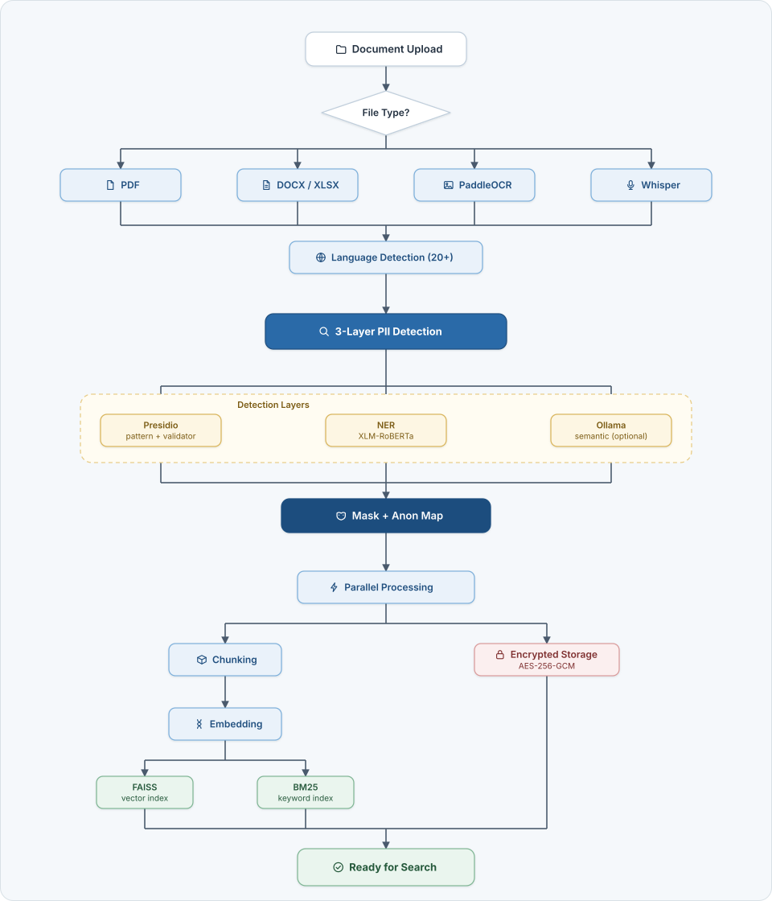

# Document Ingestion Pipeline

  <a href="./index.md"><strong>🏠 Home</strong></a>
  &nbsp;·&nbsp;
  <a href="installation.md"><strong>🚀 Installation</strong></a>
  &nbsp;·&nbsp;
  <a href="benchmark.md"><strong>📈 Benchmark</strong></a>
  &nbsp;·&nbsp;
  <a href="features.md"><strong>✨ Features</strong></a>
  &nbsp;·&nbsp;
  <a href="architecture.md"><strong>🏗️ Architecture</strong></a>
  &nbsp;·&nbsp;
  <strong>📊 Document Ingestion</strong>
  &nbsp;·&nbsp;
  <a href="screenshots.md"><strong>📸 Screenshots</strong></a>

---

How Septum turns an uploaded file into searchable, anonymised content. Every step runs **locally** — raw PII never leaves the machine.

  

## Steps

1. **Upload** — a file reaches the API. Type is identified from content bytes (`python-magic`), **never** from the extension. A `.pdf` that is actually a PNG is routed to the OCR pipeline.
2. **Format-specific ingester** — PDF through `pypdf` with per-page extraction; DOCX / XLSX through `python-docx` and `openpyxl`; images and scanned PDFs through PaddleOCR; audio through OpenAI Whisper.
3. **Language detection** — the extracted text is classified across 20+ languages. The result drives the NER model choice and validator rules used by the next step.
4. **Three-layer PII detection** — three detectors run in series and their outputs are merged:
   - **Presidio** — regex patterns + algorithmic validators (TCKN checksum, Aadhaar Verhoeff, NRIC/FIN, CPF, NINO, CNPJ, My Number, and more).
   - **NER** — transformer model chosen by language group, for `PERSON_NAME`, `LOCATION`, `ORGANIZATION_NAME`. Coverage differs by language; see [NER model coverage](#ner-model-coverage).
   - **Ollama** — optional semantic layer for context-dependent PII that patterns cannot catch (off by default; enable it under Settings → Privacy & Sanitization → *Ollama semantic detection*). Its default for a new installation comes from `USE_OLLAMA_SEMANTIC_LAYER_DEFAULT`, read once when the settings row is created.
   Overlapping spans are merged; coreferences are resolved so "Elif" and "Ms. Demir" collapse to the same placeholder index.
5. **Masking + anonymisation map** — every detected entity is replaced with a stable, type-indexed placeholder (`[PERSON_NAME_1]`, `[EMAIL_ADDRESS_3]`). The `original → placeholder` map is persisted per-document, encrypted at rest, and never leaves the air-gapped zone.
6. **Parallel processing** — two tracks run concurrently on the masked output:
   - **Chunking → Embedding → FAISS + BM25** — the masked text is split semantically (paragraph-aware with overlap), each chunk is embedded with sentence-transformers, and written to both the FAISS vector index and the BM25 keyword index.
   - **Encrypted storage** — the original file is sealed with AES-256-GCM on disk. It is never decrypted outside the air-gapped zone.
7. **Ready for search** — when all three tracks (FAISS, BM25, encrypted blob) complete, the document is flagged `ingestion_status="completed"` and becomes queryable from chat.

## NER model coverage

The NER layer runs one model per language, or two for Turkish, chosen from the language detected in step 3. Coverage is not equal across languages:

| Language | Model | Note |
|:---|:---|:---|
| `tr` | `akdeniz27/xlm-roberta-base-turkish-ner` + `savasy/bert-base-turkish-ner-cased` | Two models; their spans are merged |
| `en`, `ar`, `es`, `fr`, `pt`, `hi`, `bn`, `ur`, `vi` | `Davlan/xlm-roberta-base-wikiann-ner` | One model |
| `zh`, `ja`, `ko`, `de`, `it`, `nl`, `pl`, `ru` | `Davlan/bert-base-multilingual-cased-ner-hrl` | Chinese, Japanese, Korean and Russian recall is limited |
| `th` | `Davlan/xlm-roberta-base-wikiann-ner` | Thai NER is effectively absent (see below) |
| Any other language | `Davlan/bert-base-multilingual-cased-ner-hrl` | Fallback |

**Long texts.** The default models read at most 512 tokens per pass, special tokens included (about 510 of text). Longer texts are split into overlapping windows; each window is scanned and the results are merged into one set of positions. The regex and Presidio layers always scan the whole text.

**Optional Chinese model.** `gyr66/Ernie-3.0-base-chinese-finetuned-ner` can be chosen for `zh` in Settings → NER Models. It is never a default. Its publisher declares no licence on the Hugging Face Hub, so confirm that you have the right to use it before you enable it.

**Where NER is weak.** Thai NER is effectively absent: Thai names and places are caught mainly by the regex and Presidio layers. Chinese, Japanese, Korean and Russian NER recall is limited. The default Chinese model was chosen because it left fewer names and places unmasked on Septum's own Chinese test documents, although another model scores higher on the public WikiANN Chinese set. For these languages, do not rely on the NER layer alone. If the approval gate is enabled, review the text there before it goes to the cloud LLM.

  <a href="./index.md"><strong>🏠 Home</strong></a>
  &nbsp;·&nbsp;
  <a href="installation.md"><strong>🚀 Installation</strong></a>
  &nbsp;·&nbsp;
  <a href="benchmark.md"><strong>📈 Benchmark</strong></a>
  &nbsp;·&nbsp;
  <a href="features.md"><strong>✨ Features</strong></a>
  &nbsp;·&nbsp;
  <a href="architecture.md"><strong>🏗️ Architecture</strong></a>
  &nbsp;·&nbsp;
  <strong>📊 Document Ingestion</strong>
  &nbsp;·&nbsp;
  <a href="screenshots.md"><strong>📸 Screenshots</strong></a>

