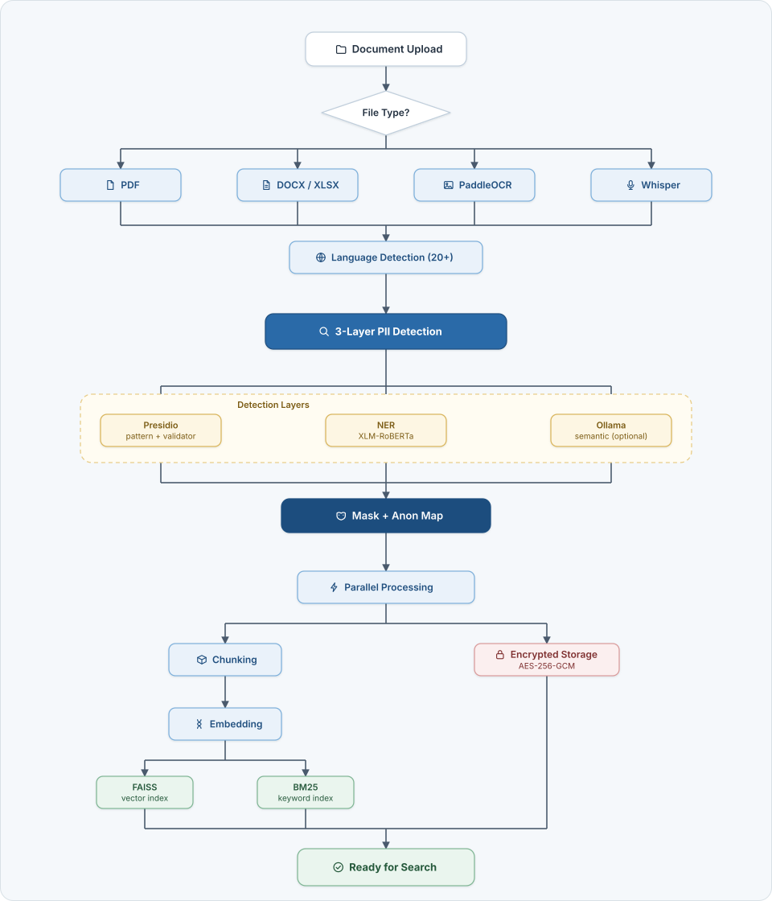

# Document Ingestion Pipeline

  <a href="./index.md"><strong>🏠 Home</strong></a>
  &nbsp;·&nbsp;
  <a href="installation.md"><strong>🚀 Installation</strong></a>
  &nbsp;·&nbsp;
  <a href="benchmark.md"><strong>📈 Benchmark</strong></a>
  &nbsp;·&nbsp;
  <a href="features.md"><strong>✨ Features</strong></a>
  &nbsp;·&nbsp;
  <a href="architecture.md"><strong>🏗️ Architecture</strong></a>
  &nbsp;·&nbsp;
  <strong>📊 Document Ingestion</strong>
  &nbsp;·&nbsp;
  <a href="screenshots.md"><strong>📸 Screenshots</strong></a>

---

How Septum turns an uploaded file into searchable, anonymised content. Every step runs **locally** — raw PII never leaves the machine.

  

## Steps

1. **Upload** — a file reaches the API. Type is identified from content bytes (`python-magic`), **never** from the extension. A `.pdf` that is actually a PNG is routed to the OCR pipeline.
2. **Format-specific ingester** — PDF through `pypdf` with per-page extraction; DOCX / XLSX through `python-docx` and `openpyxl`; images and scanned PDFs through PaddleOCR; audio through OpenAI Whisper.
3. **Language detection** — the extracted text is classified across 20+ languages. The result drives the NER model choice and validator rules used by the next step.
4. **Three-layer PII detection** — three detectors run in series and their outputs are merged:
   - **Presidio** — regex patterns + algorithmic validators (TCKN checksum, Aadhaar Verhoeff, NRIC/FIN, CPF, NINO, My Number, and more; CNPJ is matched by format only).
   - **NER** — transformer model chosen by language group, for `PERSON_NAME`, `LOCATION`, `ORGANIZATION_NAME`. Coverage differs by language; see [NER model coverage](#ner-model-coverage).
   - **Ollama** — optional semantic layer for context-dependent PII that patterns cannot catch (on for a new installation only when the setup wizard finishes with a working local model, see [First launch](installation#first-launch--setup-wizard); otherwise off; switch it under Settings → Privacy & Sanitization → *Ollama semantic detection*). `USE_OLLAMA_SEMANTIC_LAYER_DEFAULT` is read once when the settings row is created: `true` forces the layer on, `false` keeps it off. With the setting on, the local model must answer for every slice of the document text (at most 2,000 characters, neighbouring slices sharing 200 characters); if it cannot, document processing fails. Documents processed while the setting was on are flagged for re-masking.
   Overlapping spans are resolved so that no detected character goes unmasked: the higher-priority span is kept whole, with structured identifiers such as email, phone, IBAN and national IDs ranking first, and the other span keeps the part it does not cover under its own type. Two overlapping spans of the same type become one. Address layers resolve outermost first (postal address, then street address, then location), and a location partly outside an organisation or address span is masked only for the part outside it. When the uncovered part is the tail of the winner's own word, as the "nın" of "Ayşe Kaya'nın", it is folded into the winner's placeholder instead of becoming a separate one. The map records the bare value ("Ayşe Kaya"), so later bare mentions get the same placeholder, and restoring that placeholder gives the bare value. Name mentions are linked by token matching: once "Elif Demir" is a detected person, "Elif" or "Demir" reuses its placeholder index while no other person has that token, but "Ms. Demir" is not linked to it, because the title counts as a name token.
5. **Masking + anonymisation map** — every detected entity is replaced with a stable, type-indexed placeholder (`[PERSON_NAME_1]`, `[EMAIL_ADDRESS_3]`). The `original → placeholder` map is persisted per-document, encrypted at rest, and never leaves the air-gapped zone.
6. **Chunking, storage and indexing** — in this order, after masking:
   - **Chunking** — detection has already run once over the whole document, so chunks are cut afterwards along its structure (pages, headings, paragraphs, tables, sheet rows, audio segments). A cut prefers a block boundary, then a sentence end, then whitespace, and never falls inside a detected value. Text chunks are packed up to 1,200 characters for PDF and DOCX and 800 for other formats by default, and an oversized block is split with an overlap (200 characters by default); spreadsheets are cut on row boundaries (200 cells by default) and audio by time (60 seconds by default). Each chunk keeps its page, sheet number or timestamps. If a chunk is still longer than 20,000 characters after masking, the document fails with `chunk_too_large` and nothing is stored.
   - **Text size limit** — before any personal-data detection, the characters of the normalised extracted text are counted (characters, not bytes). Over `MAX_EXTRACTED_TEXT_CHARS` (10,000,000 by default) the document is refused with `extracted_text_too_large`: nothing is masked, chunked or indexed, the text is not truncated, and the document shows as failed. The encrypted original file stays until the document is deleted. Reprocessing a document that is now over the limit fails the same way and removes its previous chunks, detections, indexes and preview text, as `chunk_too_large` does. The limit exists for memory and time: at 10 million characters, detection with the default models peaked at about 3.5 GB and took about 4 to 5.5 minutes on the test machine (a desktop). A 4 GB host is tight whatever the limit, because of the loaded models. See [Upload and audio variables](installation.md#upload-and-audio-variables). The text a custom-rule Test may carry is separate: at most 20,000 characters.
   - **Chunk storage** — each chunk is stored with its masked text and with its original text, and the document's transcription text is stored too. Chat sends only the masked text to the cloud model; retrieval, local display and restoration run locally over the original text. The original chunk text and the transcription text are stored in the database unencrypted, unlike the file, the indexes and the anonymisation map, so protecting the database and its volume (disk encryption, access control) is the deployer's responsibility.
   - **Embedding → FAISS + BM25** — each chunk is embedded with sentence-transformers and written to the FAISS vector index and then the BM25 keyword index. Both indexes are built from the original chunk text, not the masked text, and stay in the air-gapped zone.
   The original file is not a step of its own: it is sealed with AES-256-GCM and written to disk at upload, before any of the steps above, and is decrypted only inside the API process: for ingestion, and when a signed-in user opens the preview of a document they own (an admin can open any), which serves the decrypted file to that user's browser. Deleting a document removes its file, its chunk rows (including the original text), its FAISS and BM25 indexes and its anonymisation map.
7. **Ready for search** — when the anonymisation map and both indexes are written, the document is flagged `ingestion_status="completed"` and becomes queryable from chat.

## NER model coverage

The NER layer runs one model per language, or two for Turkish, chosen from the language detected in step 3. Coverage is not equal across languages:

| Language | Model | Note |
|:---|:---|:---|
| `tr` | `akdeniz27/xlm-roberta-base-turkish-ner` + `savasy/bert-base-turkish-ner-cased` | Two models; their spans are merged |
| `en`, `ar`, `es`, `fr`, `pt`, `hi`, `bn`, `ur`, `vi` | `Davlan/xlm-roberta-base-wikiann-ner` | One model |
| `zh`, `ja`, `ko`, `de`, `it`, `nl`, `pl`, `ru` | `Davlan/bert-base-multilingual-cased-ner-hrl` | Chinese, Japanese, Korean and Russian recall is limited |
| `th` | `Davlan/xlm-roberta-base-wikiann-ner` | Thai NER is effectively absent (see below) |
| Any other language | `Davlan/bert-base-multilingual-cased-ner-hrl` | Fallback |

**Long texts.** The default models read at most 512 tokens per pass, special tokens included (about 510 of text). Longer texts are split into overlapping windows; each window is scanned and the results are merged into one set of positions. The regex and Presidio layers always scan the whole text.

**Optional Chinese model.** `gyr66/Ernie-3.0-base-chinese-finetuned-ner` can be chosen for `zh` in Settings → NER Models. It is never a default. Its publisher declares no licence on the Hugging Face Hub, so confirm that you have the right to use it before you enable it.

**Where NER is weak.** Thai NER is effectively absent: Thai names and places are caught mainly by the regex and Presidio layers. Chinese, Japanese, Korean and Russian NER recall is limited. The default Chinese model was chosen because it left fewer names and places unmasked on Septum's own Chinese test documents, although another model scores higher on the public WikiANN Chinese set. In Chinese and Japanese, a detected name or place is masked exactly, glyph by glyph, instead of swallowing the surrounding clause. Because Thai recall is so low, a Thai NER hit deliberately masks the whole space-free run around it, so names the model missed in the same run are covered; this over-masking is intended and applies to Thai text in any document, not only documents detected as Thai. An email address written directly next to Chinese, Japanese or Thai text is also detected. For these languages, do not rely on the NER layer alone. If the approval gate is enabled, review the text there before it goes to the cloud LLM.

  <a href="./index.md"><strong>🏠 Home</strong></a>
  &nbsp;·&nbsp;
  <a href="installation.md"><strong>🚀 Installation</strong></a>
  &nbsp;·&nbsp;
  <a href="benchmark.md"><strong>📈 Benchmark</strong></a>
  &nbsp;·&nbsp;
  <a href="features.md"><strong>✨ Features</strong></a>
  &nbsp;·&nbsp;
  <a href="architecture.md"><strong>🏗️ Architecture</strong></a>
  &nbsp;·&nbsp;
  <strong>📊 Document Ingestion</strong>
  &nbsp;·&nbsp;
  <a href="screenshots.md"><strong>📸 Screenshots</strong></a>

