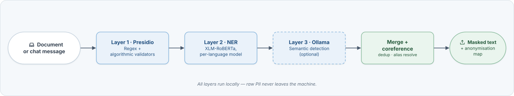
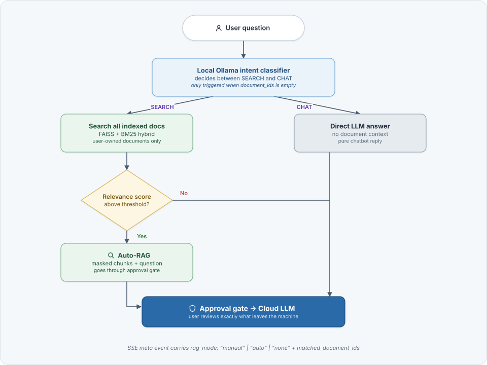

# Septum — Features & Detection Reference

<p align="center">
  <a href="./index.md"><strong>🏠 Home</strong></a>
  &nbsp;·&nbsp;
  <a href="installation.md"><strong>🚀 Installation</strong></a>
  &nbsp;·&nbsp;
  <a href="benchmark.md"><strong>📈 Benchmark</strong></a>
  &nbsp;·&nbsp;
  <strong>✨ Features</strong>
  &nbsp;·&nbsp;
  <a href="architecture.md"><strong>🏗️ Architecture</strong></a>
  &nbsp;·&nbsp;
  <a href="document-ingestion.md"><strong>📊 Document Ingestion</strong></a>
  &nbsp;·&nbsp;
  <a href="screenshots.md"><strong>📸 Screenshots</strong></a>
</p>

---

## Table of Contents

- [Detection Pipeline](#detection-pipeline)
- [Regulation Packs](#regulation-packs)
- [Auto-RAG Routing](#auto-rag-routing)
- [Documents, approval and sources](#documents-approval-and-sources)
- [Why Septum](#why-septum)
- [MCP Integration](#mcp-integration)
- [REST API & Authentication](#rest-api--authentication)

---

## Detection Pipeline

Septum runs a three-layer detection pipeline, entirely locally. Each layer
is additive — layers are merged through a coreference resolver so the same
person shows up as a single `[PERSON_NAME_1]` placeholder regardless of how they
were named.

<p align="center">
  <a href="#detection-pipeline"></a>
</p>

| Layer | Technology | Entity types |
|:---:|:---|:---|
| 1 | **Presidio** — regex patterns with algorithmic validators (Luhn, IBAN MOD-97, TCKN, CPF, SSN). Context-aware recognisers with multilingual keywords. | EMAIL_ADDRESS, PHONE_NUMBER, IP_ADDRESS, CREDIT_CARD_NUMBER, IBAN, NATIONAL_ID, MEDICAL_RECORD_NUMBER, HEALTH_INSURANCE_ID, POSTAL_ADDRESS, DATE_OF_BIRTH, DATE, MAC_ADDRESS, URL, COORDINATES, COOKIE_ID, DEVICE_ID, SOCIAL_SECURITY_NUMBER, CPF, PASSPORT_NUMBER, DRIVERS_LICENSE, TAX_ID, LICENSE_PLATE |
| 2 | **NER** — HuggingFace transformer NER, with models chosen per language group. Coverage differs by language; see [NER model coverage](document-ingestion.md#ner-model-coverage). ALL CAPS input auto-normalised to title case. LOCATION + ORGANIZATION_NAME pass through a multi-word-or-high-score gate to drop common-noun mis-fires. | PERSON_NAME, LOCATION, ORGANIZATION_NAME |
| 3 | **Ollama** — local LLM for context validation, alias detection, and semantic entities. | PERSON_NAME aliases/nicknames; DIAGNOSIS, MEDICATION, RELIGION, POLITICAL_OPINION, SEXUAL_ORIENTATION, ETHNICITY, CLINICAL_NOTE, BIOMETRIC_ID, DNA_PROFILE |

**NER models.** Settings → NER Models sets the model for each language. Several comma-separated ids run as an ensemble and their results are combined. A custom model is entered as `org/name@<40-character commit SHA>` and must provide safetensors weights; a bare id is refused with `ner_model_unpinned`. On first use, which must be online, its files are checked against the Hub's metadata for that commit. Installs that saved a bare custom id must update the setting, or that language's documents and chats fail with the same code.

**Coreference resolution.** After all three layers have produced spans, the
sanitiser collapses co-referring mentions: `"Elif"`, `"E. Demir"`, and
`"Ms. Demir"` in the same document all map to `[PERSON_NAME_1]`. This works
across sentences and across chunks of the same document.

**Layer 3 is optional.** Set `use_ollama_semantic_layer=false` in settings
to skip it. Layers 1 and 2 handle structured identifiers and names; Layer
3 adds semantic sensitive-category detection that regex and NER cannot
cover. Detection accuracy depends on the Ollama model — Septum defaults
to `aya-expanse:8b`.

---

## Regulation Packs

17 built-in regulation packs ship with Septum. Multiple can be active
simultaneously — the sanitiser applies the union of rules and the most
restrictive rule wins.

| Region | Code | Regulation |
|:---|:---|:---|
| 🇪🇺 EU / EEA | `gdpr` | General Data Protection Regulation |
| 🇺🇸 USA (Healthcare) | `hipaa` | Health Insurance Portability and Accountability Act |
| 🇹🇷 Turkey | `kvkk` | Personal Data Protection Law (6698) |
| 🇧🇷 Brazil | `lgpd` | Lei Geral de Proteção de Dados |
| 🇺🇸 USA (California) | `ccpa` | California Consumer Privacy Act |
| 🇺🇸 USA (California) | `cpra` | California Privacy Rights Act |
| 🇬🇧 United Kingdom | `uk_gdpr` | UK GDPR |
| 🇨🇦 Canada | `pipeda` | Personal Information Protection and Electronic Documents Act |
| 🇹🇭 Thailand | `pdpa_th` | Personal Data Protection Act |
| 🇸🇬 Singapore | `pdpa_sg` | Personal Data Protection Act |
| 🇯🇵 Japan | `appi` | Act on the Protection of Personal Information |
| 🇨🇳 China | `pipl` | Personal Information Protection Law |
| 🇿🇦 South Africa | `popia` | Protection of Personal Information Act |
| 🇮🇳 India | `dpdp` | Digital Personal Data Protection Act |
| 🇸🇦 Saudi Arabia | `pdpl_sa` | Personal Data Protection Law |
| 🇳🇿 New Zealand | `nzpa` | Privacy Act 2020 |
| 🇦🇺 Australia | `australia_pa` | Privacy Act 1988 |

Each row is a loadable pack under `packages/core/septum_core/recognizers/`. Legal sources for every entity type live in the [regulation entity sources doc](../packages/core/docs/REGULATION_ENTITY_SOURCES.md).

**Region-specific national ID validators** are algorithmic, not
pattern-only: TCKN (Turkey, mod-10 + mod-11 checksum), Aadhaar (India,
Verhoeff), CPF (Brazil, two-digit checksum), NRIC/FIN (Singapore, letter
checksum), Resident ID (China, ISO 7064 MOD 11-2), NINO (UK), CNPJ
(Brazil), My Number (Japan), and more. Invalid checksums are rejected, so
random 11-digit strings do not trigger false positives.

**Custom rules.** The dashboard lets admins define custom rulesets with
regex patterns, keyword lists, or LLM-prompt based detection. Custom
rules sit alongside built-in packs — policy composition rules still apply.
See [`custom-rules.md`](custom-rules.md) for worked examples per detection
method, the test loop, and audit-trail behavior.

---

## Auto-RAG Routing

When no documents are selected in the chat sidebar, Septum decides
automatically whether to search documents or answer as a plain chatbot.
Search is entity-aware: retrieval is narrowed to the documents that contain
the personal data the question refers to (see Documents, approval and
sources below).

<p align="center">
  <a href="#auto-rag-routing"></a>
</p>

Three paths result:

1. **Manual RAG** — user explicitly selects documents. Classifier skipped;
   the selection drives retrieval as before.
2. **Auto-RAG** — no selection, classifier says SEARCH, relevance score
   above threshold. Chunks retrieved across all user documents.
3. **Pure LLM** — no selection, classifier says CHAT or relevance below
   threshold. No document context attached; the LLM answers freely.

The SSE meta event gained a `rag_mode: "manual" | "auto" | "none"` field
plus `matched_document_ids` so the dashboard can show a badge on each
assistant message. Threshold lives in the RAG settings tab as
`rag_relevance_threshold` (default 0.35).

---

## Documents, approval and sources

- **Approval gate.** Before any cloud call, the dashboard shows the masked prompt, the retrieved chunks and the assembled request side by side; you approve or reject. A new install starts with the gate on (`require_approval`, changeable in settings).
- **Stale-document flagging.** A document processed under an older policy is flagged on the Documents page when the active policy gains entity types (a built-in pack update, or a newly activated regulation or custom rule), when the detection engine version changes, or when custom recognizers or non-PII (allow-list) rules are added, edited or removed. Deactivating a regulation alone does not flag it. Flagged documents show a "Needs reprocessing" badge, a banner, and a "Reprocess outdated (N)" button. When no entity types are missing, the badge reads "Sanitized under an older privacy policy". Until a document is reprocessed, chat re-masks its retrieved chunks with the current policy and caches the result, before anything leaves the machine. Documents from before this version have no recorded policy and are flagged once.
- **Document limit.** A question uses at most 50 documents.
- **Hybrid retrieval.** Chunks are found by FAISS semantic search and BM25 keyword search, merged with Reciprocal Rank Fusion.
- **Entity-aware Auto-RAG.** When several documents match, Auto-RAG narrows retrieval to documents that contain the queried personal data. If the matches are ambiguous, a disambiguation picker asks you which group to use.
- **Source citation.** Under each grounded answer, a collapsible summary shows how many documents and chunks fed it; expanding it lists each document with its chunk count.
- **Document relationship graph.** A cytoscape map shows which documents share entities. Shared identifiers (IBAN, national ID, passport and similar) count fully; common signals such as locations and dates count very little, so they do not dominate the graph.
- **Rich formats.** PDFs, Office files, spreadsheets, images (OCR), audio (Whisper) and e-mails; see [Document ingestion](document-ingestion.md).
- **Access control.** JWT sessions with the `admin`, `editor` and `viewer` roles, plus API keys (see REST API & Authentication below).
- **Audit trail.** An append-only log of detection and document events, with entity counts and no raw personal data; see [Architecture](architecture.md).

---

## Why Septum

| Capability | Septum | Plain ChatGPT / Claude | Azure Presidio | LangChain pipeline |
|:---|:---:|:---:|:---:|:---:|
| PII masked before cloud | **Yes** | No | Detection only | Build yourself |
| Multi-regulation (17 packs) | **Yes** | No | No | Build yourself |
| Approval gate before LLM | **Yes** | No | No | Build yourself |
| De-anonymisation (real values) | **Yes** | N/A | No | Build yourself |
| Document RAG with hybrid retrieval | **Yes** | No | No | Partial |
| Auto-RAG intent routing | **Yes** | No | No | Build yourself |
| Custom detection rules | **Yes** | No | Limited | Build yourself |
| Ready-to-use web UI | **Yes** | N/A | No | No |
| Audit trail & compliance | **Yes** | No | No | Build yourself |
| Works with any LLM provider | **Yes** | Single | Azure only | Configurable |
| Fully self-hosted | **Yes** | No | Cloud service | Depends |

Other tools offer pieces of the puzzle — detection here, a vector store
there. Septum is the complete end-to-end pipeline: detection →
anonymisation → mapping → retrieval → approval → LLM call →
de-anonymisation → audit. Out of the box, with a UI, for any regulation.

---

## MCP Integration

Septum ships a standalone **Model Context Protocol** server,
[`septum-mcp`](../packages/mcp/), that plugs the same local PII masking
pipeline into any MCP-aware client. MCP is an open, vendor-neutral
[specification](https://modelcontextprotocol.io) — the server supports
all three standard transports:

- **stdio** (default) — for subprocess-launching clients: Claude
  Desktop, Cursor, Windsurf, ChatGPT Desktop, Zed, and anything built
  against the Python / TypeScript / Rust / Go / C# / Java SDKs.
- **streamable-http** — modern HTTP transport for remote, browser, or
  containerised clients. Bearer-token auth via
  `Authorization: Bearer <SEPTUM_MCP_HTTP_TOKEN>`.
- **sse** — legacy HTTP + Server-Sent Events transport, kept for
  clients that haven't migrated to streamable-http yet.

`septum-core` runs in-process; raw PII never reaches the network.

**Tools exposed:**

| Tool | Purpose |
|:---|:---|
| `mask_text` | Mask PII in a snippet and return a session id. |
| `unmask_response` | Restore originals inside an LLM reply using the session id. |
| `detect_pii` | Read-only scan — returns entities without retaining a session. |
| `scan_file` | Read a local file (`.txt`, `.md`, `.csv`, `.json`, `.pdf`, `.docx`) and scan it. |
| `list_regulations` | List the 17 built-in regulation packs with their declared entity types. |
| `get_session_map` | Return `{original → placeholder}` for local debugging only. |

**Stdio client** (Claude Desktop, Cursor, Windsurf, Zed, ChatGPT Desktop):

```json
{
  "mcpServers": {
    "septum": {
      "command": "septum-mcp",
      "env": {
        "SEPTUM_REGULATIONS": "gdpr,kvkk",
        "SEPTUM_LANGUAGE": "en"
      }
    }
  }
}
```

**HTTP client** (remote agent, browser extension, shared team server):

```json
{
  "mcpServers": {
    "septum": {
      "url": "https://mcp.example.com/mcp",
      "headers": {
        "Authorization": "Bearer <your-token>"
      }
    }
  }
}
```

Run the HTTP server yourself:

```bash
SEPTUM_MCP_HTTP_TOKEN=$(openssl rand -hex 32) \
  septum-mcp --transport streamable-http --host 0.0.0.0 --port 8765
```

The server is built on the MCP Python SDK 2.x. For a non-loopback HTTP bind, set `SEPTUM_MCP_HTTP_ALLOWED_HOSTS` (or `--allowed-hosts`) to the host names clients use; it enables DNS-rebinding protection.

See the [MCP server guide](../packages/mcp/README.md) for the
complete HTTP deployment guide (Docker, compose profiles, TLS
reverse-proxy pattern), environment variable reference, and
end-to-end tool examples.

---

## REST API & Authentication

The Septum backend ships a FastAPI REST layer documented at `/docs`
(Swagger) and `/redoc`. Two authentication methods are supported.

### JWT (browser sessions, short-lived)

The setup wizard creates the first admin account; subsequent logins
return a JWT good for 24 hours.

```bash
curl -X POST http://localhost:3000/api/auth/login \
  -H 'Content-Type: application/json' \
  -d '{"email": "admin@example.com", "password": "your-password"}'
# → {"access_token": "...", "token_type": "bearer"}
```

### API keys (CI/CD, MCP integrations, long-lived)

Admins issue programmatic API keys via `POST /api/api-keys`. The raw key
is shown **once** at creation; only its 8-character prefix and a SHA-256
hash are persisted.

```bash
# Create a key (response includes raw_key — store it now, you cannot retrieve it later)
curl -X POST http://localhost:3000/api/api-keys \
  -H 'Authorization: Bearer <jwt>' \
  -H 'Content-Type: application/json' \
  -d '{"name": "ci-pipeline", "expires_at": null}'

# Use it on any subsequent request
curl -H 'X-API-Key: sk-septum-<64 hex chars>' http://localhost:3000/api/auth/me

# List keys (prefixes + metadata only — raw keys are never returned again)
curl -H 'Authorization: Bearer <jwt>' http://localhost:3000/api/api-keys

# Revoke
curl -X DELETE -H 'Authorization: Bearer <jwt>' http://localhost:3000/api/api-keys/{id}
```

API keys are for data and read automation. They cannot manage API keys, users or passwords, change provider settings or infrastructure, or edit the masking policy (regulation activation, custom recognizers, non-PII rules, text normalization); those requests return `401` or `403` and need an interactive login (JWT).

### Rate limits

| Endpoint | Limit |
|:---|:---|
| `POST /api/auth/register` | 3 / minute per client |
| `POST /api/auth/login` | 5 / minute per client; after 100 failures for one email in an hour, only clients that themselves failed for that email are refused |
| `POST /api/auth/change-password` | 5 / minute per user |
| `POST /api/api-keys` | 10 / minute |
| `POST /api/chat/ask` | 30 / minute |
| `GET /api/setup/status` | 120 / minute |
| `POST /api/error-logs/frontend` | 60 / hour per client; IPv6 also 120 / hour per /48 |
| Setup-token failures (every setup-gated route) | 10 / minute per client |
| Everything else | 600 / minute (configurable via `RATE_LIMIT_DEFAULT`) |

Limits count per route and identity: the **API key prefix** for API-key requests, the user for signed-in requests, and the client address otherwise, so services behind a shared NAT each get their own quota. Login, register and setup routes always count per client address, even for signed-in callers. IPv6 clients count per /64. Failed-login and setup-token counters use the /48. Login and register each also have a 60-per-minute cap per IPv6 /48. These IPv6 rules apply only when the API sees real IPv6 client addresses; with the default compose network (IPv4 only), IPv6 visitors arrive through Docker's proxy and share one IPv4 bucket.

A 429 response carries `Retry-After`. Login, register and password change can return `503` with code `server_busy` when the password-hashing queue is full, or when the same caller already has a password check in progress; the response carries `Retry-After: 2`.

Document uploads have their own limits: `401` without a valid login (checked before the body is read); `503` with `server_busy` and `Retry-After: 5` when every upload slot of the worker is taken; `413` for a file over `MAX_UPLOAD_BYTES`; and `408` when the client sends no data for 30 seconds or when the whole body takes longer than `UPLOAD_BODY_TIMEOUT_SECONDS` (900 seconds by default). See [Upload and audio variables](installation.md#upload-and-audio-variables).

Limits are stored in Redis when Redis is configured (`REDIS_URL`, or the Redis URL saved by the setup wizard, applied after a restart), otherwise in process memory, which is only correct for a single process. During a Redis outage, general limits fail open, while login, register, password change, frontend error reports, the failed-login counters, the setup-token counter and the error-log budgets keep counting in memory (per process). Run more than one API worker (`WEB_CONCURRENCY` above 1) only with `REDIS_URL` set, and complete first-time setup with one worker or set `SEPTUM_SETUP_TOKEN`. See [Access and network settings](installation.md#access-and-network-settings) for the related settings.

### Quick API example

```bash
# Upload a document
curl -X POST http://localhost:3000/api/documents/upload \
  -H "Authorization: Bearer $TOKEN" \
  -F "file=@contract.pdf"

# Ask a question (streamed response via SSE)
curl -N -X POST http://localhost:3000/api/chat/ask \
  -H "Authorization: Bearer $TOKEN" \
  -H "Content-Type: application/json" \
  -d '{"message": "What are the termination clauses?", "document_id": 1}'
```

The chat endpoint returns Server-Sent Events:
`meta` → `approval_required` → `answer_chunk` → `end`.

For the complete API reference, pipeline details, and deployment
topologies, see the [Architecture](architecture.md) doc.

---

<p align="center">
  <a href="./index.md"><strong>🏠 Home</strong></a>
  &nbsp;·&nbsp;
  <a href="installation.md"><strong>🚀 Installation</strong></a>
  &nbsp;·&nbsp;
  <a href="benchmark.md"><strong>📈 Benchmark</strong></a>
  &nbsp;·&nbsp;
  <strong>✨ Features</strong>
  &nbsp;·&nbsp;
  <a href="architecture.md"><strong>🏗️ Architecture</strong></a>
  &nbsp;·&nbsp;
  <a href="document-ingestion.md"><strong>📊 Document Ingestion</strong></a>
  &nbsp;·&nbsp;
  <a href="screenshots.md"><strong>📸 Screenshots</strong></a>
</p>

